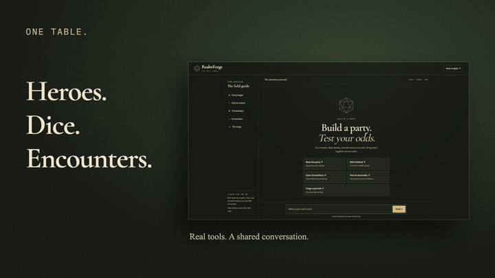

# RealmForge: Turn-Based RPG Party Builder

**RealmForge** is an interactive, conversational RPG companion built on Google's Agent Development Kit (ADK) and Gemini. It enables players to recruit and manage a party of adventurers in Google Cloud Firestore, roll polyhedral dice, query monsters from the D&D 5e Bestiary, run complex combat simulations in a secure Vertex AI Agent Engine code sandbox, generate custom fantasy portraits via Gemini (`gemini-3.1-flash-lite-image`), generate cinematic animations via Google Omni (`gemini-omni-flash-preview`), and render rich turn-based UI cards with **A2UI**.



[Watch the 50-second demo with music](docs/demo.mp4) · [Version without music](docs/demo-nobgm.mp4)

The demo uses real tool output and generated media from a verified frontend
conversation. Waiting time is edited. The encounter percentage comes from a
simplified sandbox simulation; its assumptions are shown in the video.

The frontend now uses a dark fantasy tabletop theme, quick prompts, hero health
bars and stat pills, actual-roll animation, and framed inline images and video.
It supports keyboard focus, reduced motion, and narrow mobile screens.

---

## ⚔️ Implemented Features & Architecture

- **🧠 Cross-Session Long-Term Memory (Vertex AI Memory Bank)**:
  - Loads and stores party preferences and combat notes with `PreloadMemoryTool` and `generate_memories_callback`.
  - Cross-session recall needs a stable user ID, as in `adk web`. Each new chat context in the custom A2A frontend has a different anonymous identity. Those contexts use conversation history and skip Memory Bank reads/writes, so unavailable cross-session memory cannot block a turn. Hero records still persist in Firestore.
- **🛡️ Hero Party Management (Google Cloud Firestore)**:
  - Real-time persistent state stored in a dedicated Firestore `heroes` collection.
  - Tools: `list_heroes`, `get_hero`, `create_or_update_hero`, `update_hero_hp`, and `delete_hero`.
- **🎲 Polyhedral Dice Engine**:
  - Random dice rolls (`d4`, `d6`, `d8`, `d10`, `d12`, `d20`, `d100`) with modifiers for initiative, attack rolls, and healing (`roll_dice`). The frontend animates the actual roll result.
- **🐉 5e SRD Monster Bestiary API**:
  - Free public live API integration querying creature statistics, armor class, challenge ratings, traits, and actions (`lookup_monster`).
- **🎨 Fantasy Character & Item Generation**:
  - Generates character portraits and item illustrations using Gemini image models (`gemini-3.1-flash-lite-image`), saves them as local ADK artifacts, and uploads them to a public Cloud Storage bucket for direct inline rendering (`generate_item_image`).
- **🎬 Cinematic Video Animations**:
  - Generates short animation clips using Google Omni (`gemini-omni-flash-preview`), saves them as artifacts, and uploads them to Cloud Storage for persistent streaming (`generate_item_video`).
- **💻 Vertex AI Sandboxed Code Execution**:
  - Securely executes Python in an isolated `AgentEngineSandboxCodeExecutor` environment to compute complex damage distributions, win percentages, and turn-based battle simulations.
- **🃏 A2UI Rich Card Display (v0.8)**:
  - Emits schema-compliant A2UI data payloads rewrapped by `a2ui_callback` to render responsive visual cards, hero sheets, and combat summaries in the dev UI.

---

## 📋 Roadmap & Backlog

The following features from the initial design brief are planned for future iterations:

- [ ] **Turn-by-Turn Combat Log Table**: Multi-round automated battle runner formatted into interactive A2UI tabular rows.
- [ ] **Loot & Reward Generator**: Dynamic loot table drops based on defeated monster Challenge Rating (CR).
- [ ] **Custom Audio Soundtrack**: Ambient battle themes and sound effects generated with Lyria.

---

## 🚀 Local Setup & Development

### Prerequisites

- Python 3.11+
- [`uv`](https://docs.astral.sh/uv/) package manager
- Google Cloud SDK (`gcloud`) with Application Default Credentials (ADC) configured:
  ```bash
  gcloud auth application-default login
  ```

### Installation

```bash
# Clone repository
git clone https://github.com/mugnimaestra/realmforge-party-builder.git
cd realmforge-party-builder

# Install dependencies
uv sync
```

### Run the themed frontend locally

Use ADC from an account that can access this project's Firestore, Vertex AI, Memory Bank, sandbox, and asset bucket. Do not put credentials in the browser or the repository.

In the repository root, set the model backend and seed the example party:

```bash
export GOOGLE_GENAI_USE_VERTEXAI=true
export GOOGLE_CLOUD_PROJECT=qwiklabs-gcp-04-858b990e3059
export GOOGLE_CLOUD_LOCATION=global
uv run python scripts/seed_firestore.py
```

The seeder replaces the four example hero records. Skip it if you want to keep changes to those heroes.

Start the agent in that terminal:

```bash
APP_URL=http://localhost:8000 uv run python -m app.fast_api_app
```

In a second terminal, start the proxy from `frontend/`:

```bash
cd frontend
unset AGENT_ENGINE_RESOURCE_NAME
uv run python main.py
```

Open [localhost:8080](http://localhost:8080). Without `AGENT_ENGINE_RESOURCE_NAME`, the proxy sends A2A requests to `http://localhost:8000/a2a/app` without authentication headers. The local agent uses server-side ADC for its cloud tools. To connect to a deployed agent, set `AGENT_ENGINE_RESOURCE_NAME` before starting the proxy; that mode uses ADC authentication.

The Gemini model uses the global endpoint. Memory Bank and the sandbox stay in their configured region, `us-east1`. The model and project IDs remain unchanged.

### Running the Agent Playground Locally

Start the local ADK web interface:

```bash
uv run python -m app.fast_api_app
```

> **Tip:** In the web UI, create a **New Session** and turn **Token Streaming** **OFF** in settings ⚙️ to view the rendered A2UI cards.

The server also provides the ADK playground at [localhost:8000](http://localhost:8000).

### Checks

```bash
uv run pytest tests/unit
# With the local frontend running; uses Chrome and does not capture test data:
uv run --with patchright python scripts/check_frontend.py
# Real cloud tools, with both local servers running:
uv run --with patchright python scripts/check_live_agent.py
```

### Demo source and license

The editable [demo project](demo/README.md) uses Remotion, with video-shotcraft
camera recipes and the hyperframes-motion-reel reference's beat grid and kinetic
type. Remotion is free for individuals and companies with three or fewer
employees; this is a personal hackathon project. See the [Remotion license](https://www.remotion.dev/license).
The project includes an original 120 BPM score and attributed cinematic sound
effects. Source and asset licenses are recorded in [demo/ATTRIBUTION.md](demo/ATTRIBUTION.md).

---

## 📦 Project Structure

```
realmforge-party-builder/
├── app/
│   ├── agent.py               # Root ADK agent, tools, schema, & sandbox configuration
│   ├── a2ui_utils.py          # A2UI v0.8 response unwrapping callback
│   ├── fast_api_app.py        # FastAPI server & A2A protocol router
│   └── app_utils/             # Service registries, session, and artifact managers
├── frontend/                  # Minimal FastAPI proxy and A2A chat web UI
├── scripts/
│   └── seed_firestore.py      # Firestore initial hero party seeder
├── tests/                     # Unit and evaluation datasets
├── pyproject.toml             # Dependencies & UV lock specifications
└── README.md                  # Project documentation & backlog
```
